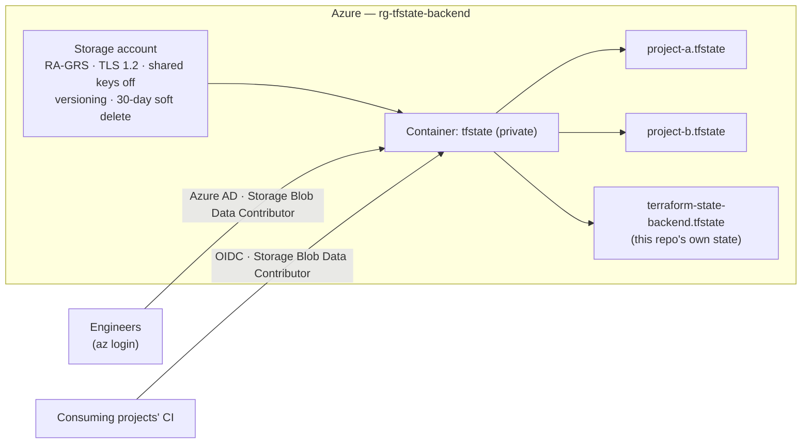
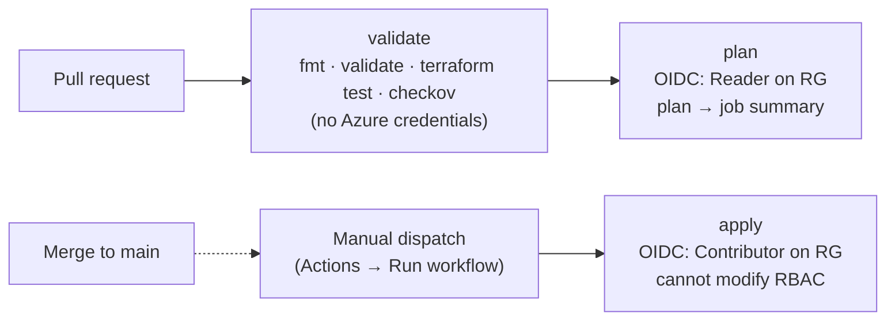

# terraform-state-backend

[](https://github.com/Josperdo/terraform-state-backend/actions/workflows/terraform-ci.yml)

A shared, hardened Azure remote-state backend for Terraform. This repo
provisions one resource group, one storage account, and one private blob
container that other Terraform projects use as their `backend "azurerm"`.
Each consumer gets automatic state locking, versioned recovery, and
access controlled entirely by Azure AD RBAC: storage account keys are
disabled, and CI authenticates with OIDC rather than stored secrets.

## Architecture





## Design decisions

| Decision | Why |
| --- | --- |
| One storage account and container shared by all consumers, separated by blob `key` | Keeps the backend simple; one place to harden, monitor, and recover |
| Shared key access **disabled**; every consumer uses `use_azuread_auth = true` | No long-lived shared secret to distribute or rotate, and nothing that bypasses RBAC |
| Blob versioning + 30-day soft delete (blobs and containers) | Recovers from a bad `apply` or an accidental `terraform state rm` with no separate backup system |
| RA-GRS replication | State files are kilobytes; geo-redundancy costs almost nothing |
| `prevent_destroy` on every resource **and** a `CanNotDelete` lock on the resource group | `prevent_destroy` only stops this Terraform config; the lock is enforced by Azure itself, so it also blocks the portal, CLI, and API. One accidental delete here would take every consumer's state with it |
| OIDC federation for CI, with **separate plan and apply identities** | No client secrets. A PR can only ever reach a Reader identity; writes need a manual dispatch from `main` |
| Apply identity is Contributor (excludes `Microsoft.Authorization/*/write`) | CI is structurally unable to change who has access; `rbac.tf` is applied by a human |
| Partial backend config for this repo's own state | Real resource names come from `-backend-config` at init time, not tracked files |

## What's been verified (against real Azure, not just on paper)

- **Locking:** two concurrent `apply`s against the same key. The second failed
  immediately with `Error acquiring the state lock` / `state blob is already
  locked`, and the lease released cleanly afterward (see [State locking](#state-locking)).
- **Least privilege:** a zero-role service principal was **denied**
  (`AuthorizationPermissionMismatch`), granted access through `rbac.tf`,
  confirmed able to read *and* write, then revoked and deleted.
- **CI end to end:** real PRs through `validate` → `plan` with the
  read-only identity, then manual `apply` dispatches. One was a no-op; one
  changed real infrastructure (LRS → RA-GRS), confirmed independently with
  `az storage account show`.
- **A bug only least privilege could find:** without
  `storage_use_azuread = true`, the azurerm provider silently calls
  `listKeys` for some storage reads. That worked under elevated local
  credentials and failed under the Reader-only CI identity, which is how
  it was found. The fix is in [providers.tf](providers.tf).

On every PR, CI also runs `terraform test` ([tests/](tests/)) to assert
the security baseline (keys off, no public access, TLS 1.2, versioning,
soft delete, private container) and a checkov scan. Every checkov
exception is justified inline in [main.tf](main.tf).

## Repository layout

| File | Purpose |
| --- | --- |
| [main.tf](main.tf) | Resource group, storage account, container |
| [rbac.tf](rbac.tf) | Role assignments for consumers and the two CI identities (applied locally only) |
| [locks.tf](locks.tf) | `CanNotDelete` lock on the resource group (applied locally only) |
| [variables.tf](variables.tf) / [outputs.tf](outputs.tf) | Inputs (with validation) and the values consumers need |
| [providers.tf](providers.tf) / [backend.tf](backend.tf) | Provider config; this repo's own remote state (partial config) |
| [backend.tf.example](backend.tf.example) | Template for consuming projects |
| [tests/](tests/) | `terraform test` suite with a mocked provider, so it needs no Azure credentials |
| [.github/workflows/terraform-ci.yml](.github/workflows/terraform-ci.yml) | validate / plan / apply pipeline |
| [docs/disaster-recovery.md](docs/disaster-recovery.md) | Runbook for losing the backend itself |

## Usage

### Prerequisites

- Terraform >= 1.7
- Azure CLI, logged in (`az login`)
- To deploy the backend: rights to create a resource group and storage
  account, and to assign roles (e.g. Owner or User Access Administrator) on it
- To *consume* an existing backend: the **Storage Blob Data Contributor**
  role on the storage account (see [Access model](#access-model))

### Deploying this backend (first time)

This repo stores its own state in the backend it creates, so the first
deploy has to run with local state and then migrate:

1. `cp terraform.tfvars.example terraform.tfvars` and fill in real
   values. `storage_account_name` must be globally unique
   (`az storage account check-name --name <name>`). Put your own object
   ID (`az ad signed-in-user show --query id -o tsv`) in
   `consumer_principal_object_ids`. Owner on the subscription does
   **not** include blob data access.
2. Temporarily disable the remote backend so Terraform uses local state:
   `mv backend.tf backend.tf.bootstrap`
3. `terraform init`, `terraform plan`, `terraform apply`
4. Restore the backend and migrate the local state into it:
   ```sh
   mv backend.tf.bootstrap backend.tf
   cp backend-config.hcl.example backend-config.hcl   # fill in from `terraform output`
   terraform init -migrate-state -backend-config=backend-config.hcl
   ```
   New role assignments can take a few minutes to propagate. If the
   migration gets a 403, wait and retry.
5. After confirming `terraform plan` shows no changes, delete the local
   `terraform.tfstate*` files.

On a machine where the backend already exists, skip to
`terraform init -backend-config=backend-config.hcl`.

### Pointing another project's state here

1. Copy [backend.tf.example](backend.tf.example) into the consuming repo
   as `backend.tf`.
2. Fill in `resource_group_name` / `storage_account_name` /
   `container_name` from this repo's `terraform output`.
3. Choose a **unique `key`**, such as the repo name (`my-project.tfstate`).
   Keep `use_azuread_auth = true`.
4. Make sure the identity running Terraform there is listed in
   `consumer_principal_object_ids` and that this repo has been re-applied.
5. `terraform init`, then `terraform plan` to confirm. An auth error or
   "storage account not found" means steps 2–4 need another look.

To see what's stored:

```sh
az storage blob list --account-name <storage_account_name> \
  --container-name <container_name> --auth-mode login -o table
```

## Access model

- **No storage account keys.** Shared key access is disabled on the
  account, so Azure AD RBAC is the only way to read or write state, for
  people and for CI.
- Consumers need **Storage Blob Data Contributor** on the storage
  account. Owner/Contributor do **not** include it, because control-plane
  and data-plane permissions are separate layers in Azure.
- Access is managed in [rbac.tf](rbac.tf): add or remove an object ID in
  `consumer_principal_object_ids` and `terraform apply` locally. CI never
  applies `rbac.tf`.
- CI uses **OIDC federation**. GitHub issues a short-lived,
  workflow-scoped token that Azure AD trusts through a federated
  credential, and no client secret exists anywhere.

## CI/CD

Every PR that touches Terraform files runs **validate** (fmt, validate,
`terraform test`, checkov; no cloud credentials) and **plan** (read-only
identity, plan posted to the job summary).

Applying is deliberately manual. After merging, go to **Actions → Terraform
CI → Run workflow** on `main`. The apply job plans to a file, records that
plan in the job summary, and applies exactly that file, using a
Contributor identity scoped to this resource group. Both jobs `-target`
only the three backend resources. Role assignments and the delete lock
stay local and manual, by policy and by permission: Contributor can't
manage either.

GitHub's "required reviewers" environment rule isn't available for
private repos on the free plan. Requiring a manual dispatch is the
equivalent here: nothing writes to Azure unless someone chooses to run
it.

## State locking

The `azurerm` backend locks state automatically with a blob lease; no
extra resource is needed. This was tested with a 25-second `time_sleep`
holding one apply open while a second ran against the same key:

```
Error: Error acquiring the state lock

Error message: state blob is already locked
Lock Info:
  ID:        5d16c90e-bcd4-e0f7-5129-044159ee985c
  Path:      tfstate/<key>.tfstate
  Operation: OperationTypeApply
  Who:       <user>@<machine>
  Version:   1.14.6
  Created:   2026-08-10 20:33:06 UTC
```

The default `-lock-timeout` is `0s`, so the second run fails immediately.
Pass `-lock-timeout=5m` to wait instead (CI does this). **Stuck lock**
(e.g. a job killed mid-apply): confirm nothing is still running against
that key, then run `terraform force-unlock <LOCK_ID>`. Never force-unlock
while another apply might still be in flight.

## Known limitations

- **Account-wide data access.** Storage Blob Data Contributor is scoped
  to the storage account, so any consumer, including the CI plan
  identity, can read or write *every* project's state blob, not just its
  own. Planned fix: Azure ABAC conditions that limit each principal to its
  own key (see [Roadmap](#roadmap)).
- **Key collisions are prevented by convention only.** Two consumers that
  use the same `key` would share one state file. The ABAC work above
  would turn this into an enforced boundary.
- **Public network endpoint.** GitHub-hosted runners have dynamic IPs, so
  the account isn't behind a firewall or private endpoint. Access still
  requires an Azure AD identity with an explicit role assignment.
- **Recreating the resource group needs a human.** The CI apply identity
  is scoped to the resource group, so it can't recreate the group if it's
  deleted. That's deliberate: CI gets no standing subscription-level
  access. See [docs/disaster-recovery.md](docs/disaster-recovery.md).

## Roadmap

- [ ] Per-consumer ABAC conditions (each principal can only access its own state key)
- [x] `CanNotDelete` management lock on the resource group ([locks.tf](locks.tf))
- [ ] Blob read audit logging (diagnostic settings → Log Analytics)

## License

[MIT](LICENSE)
